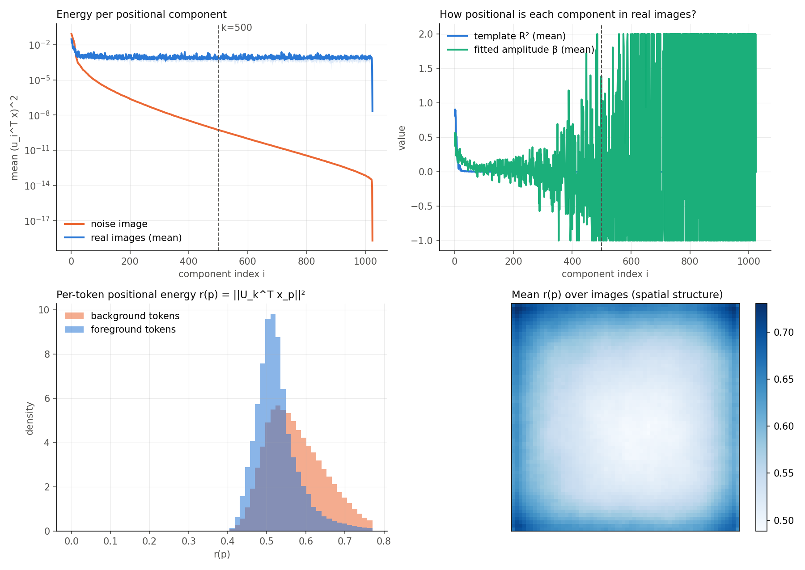

# Colab verification results

**Setup.** Google Colab Tesla T4 (15 GB), with PyTorch's allocator capped at **8 GB** (`--max-vram-gb 8`).
DINOv3 weights are the official `facebook/dinov3-vit{l,b}16-pretrain-lvd1689m` (HF transformers). Masks use bilinear
upsampling (no CRF), 1-shot, seed 0. Each run evaluates the **first N episodes** of the benchmark's fixed
episode sequence, and every variant in a run sees **identical episodes**, so differences between variants are paired comparisons.
The exact commands are in [`colab/verify_queue.sh`](../colab/verify_queue.sh). Subset sizes were chosen to fit the free-tier
GPU quota, so differences under about 0.5 mIoU should be treated as noise until the full protocol is run (see the run guide).

**Resources.** Peak VRAM is **6.05 GB** for segmentation (DINOv3-L, 1024 px) and **1.58 GB** for SPair (DINOv3-B, 768 px),
so everything fits in 8 GB. On the T4, a segmentation episode takes about 7 s (encoder ~5 s with bf16 emulation, agglomerative
clustering ~2 s on 2 CPU cores). Each extra debiasing variant adds about 0.05 s and each multi-prototype variant 0.2–0.3 s,
because features and clustering are shared across variants. An Ampere or newer 8 GB GPU is faster (native bf16).

**Equivalence check.** `experiments/check_equivalence.py` on the real DINOv3-L: `INSID3Ext` with default settings gives
predictions bit-identical to the original `INSID3`. The generic soft-projection path with hard weights matches the closed form
to 1.6e-7, and `template_hybrid(λ=1)` matches `hard` to 1e-6.

---

## 1. Reproduction

| benchmark | protocol | ours (mIoU / PCK) | paper |
|---|---|---|---|
| Chest X-Ray | **original `inference_segmentation.py`, full 600 episodes**, bilinear | **77.0** | 78.8 (with CRF) |
| COCO-20i fold 0 | first 250 episodes, `hard (INSID3)` | **57.37** | 57.6 (4 folds, Tab. 5) |
| COCO-20i fold 0 | same episodes, no debiasing | 52.14 | 54.5 (Tab. 5) |
| ISIC | first 150 episodes | 51.12 | 54.4 (with CRF) |
| SPair-71k (ViT-B, 768, k=20) | first 2000 pairs, debiased / original | 62.26 / 54.19 PCK@0.10 | 52.6 / 46.8 (all 12k pairs) |

The SPair pairs are ordered by category, so the first 2000 pairs are the easier classes (aeroplane, bicycle, ...). The
absolute PCK is higher than the full-benchmark number; the gain from debiasing (+8.1) matches the paper (+5.8 for ViT-B).

---

## 2. Task 1: Adaptive Positional Debiasing

### 2a. Analysis of the positional components (COCO-20i, 100 images, DINOv3-L, k=500)

| measurement | value |
|---|---|
| noise-image energy captured by the top-500 subspace | 100.0 % |
| **real-image feature energy removed by the hard projection** | **56.9 %** (± 2.6 % across images) |
| template R² (how much of a component's spatial map in a real image is explained by its positional template), first 10 components | **0.56** |
| template R², components 1–500 | 0.014 |
| fitted positional amplitude β, first 10 components | 0.36 ± 0.09 across images |
| per-token positional energy, foreground / background tokens | 0.527 / 0.575 |
| positional energy std within an image / across images | 0.069 / 0.026 |

Findings:
* **Positional information is concentrated in the first ~10–20 components.** There the spatial pattern in real images
  matches the noise-image templates (R² up to 0.9). Beyond about 30 components the directions carry flat,
  image-specific energy that is not coordinate-aligned (R² ≈ 0).
* The hard projection with k=500 removes **57 %** of the feature energy, close to what 500 random directions in 1024-D would
  remove (49 %). So **most of what is removed is not positional**, which motivates soft debiasing.
* Positional energy varies more within an image (across tokens) than across images. It is higher on background tokens and at
  the **image borders and corners** (bottom-right panel), the low-semantic-content regions where coordinate bias shows up.

### 2b. Segmentation mIoU

| variant | COCO-20i f0 (250) | ISIC (150) | Chest X-Ray (150) |
|---|---|---|---|
| none | 52.14 | 50.14 | **76.15** |
| **hard (INSID3)** | 57.37 | 51.12 | 75.89 |
| spectral ρ=0.5 | 57.86 | 51.17 | 75.89 |
| **spectral ρ=1** | **58.25** | 51.55 | 75.89 |
| spectral ρ=2 | 57.37 | **51.78** | 75.89 |
| soft_rank t=0.05 / 0.1 / 0.2 | 57.04 / 57.04 / 57.18 | 51.65 / 51.49 / 51.48 | 75.89 / 75.89 / 75.93 |
| token η=0.5 / 1 / 2 | 57.39 / 55.56 / 54.96 | 51.54 / 50.88 / 50.76 | 75.95 / 75.95 / 76.12 |
| template | 56.71 | 49.97 | 76.15 |
| template_hybrid λ=0.25 / 0.5 / 0.75 | 56.57 / 56.19 / 57.25 | 51.14 / 51.22 / 51.03 | 76.18 / 75.95 / 75.95 |
| hard k=50 / 100 / 200 | 56.79 / 56.61 / 56.39 | 51.32 / 51.07 / 51.42 | 76.17 / 75.95 / 75.95 |
| spectral k=50 / 100 / 200 | 56.25 / 56.63 / 56.29 | 51.66 / 51.52 / 51.47 | 76.15 / 75.95 / 75.95 |
| soft_rank k=200 t=0.5 | 56.58 | 51.21 | 75.95 |
| token k=100 η=1 | 54.58 | 51.21 | 76.17 |
| template k=100 | 56.71 | 49.97 | 76.15 |
| template_hybrid λ=0.9 | 57.37 | 51.15 | 75.89 |

### 2c. Semantic correspondence, SPair-71k (first 2000 pairs, ViT-B, 768 px, k=20)

| variant | PCK@0.05 | PCK@0.10 | PCK@0.15 | PCK@0.20 |
|---|---|---|---|---|
| none | 37.24 | 54.19 | 61.92 | 66.88 |
| **hard (INSID3)** | 43.12 | 62.26 | 70.51 | 75.75 |
| spectral ρ=0.5 / 1 / 2 | 43.14 / 43.18 / **43.22** | 62.27 / 62.29 / 62.27 | 70.71 / 70.68 / 70.57 | 75.75 / 75.79 / 75.74 |
| soft_rank t=0.05 / 0.1 / 0.2 | 43.15 / 43.11 / 43.14 | 62.21 / 62.17 / 62.20 | 70.49 / 70.47 / 70.49 | 75.70 / 75.71 / 75.70 |
| token η=0.5 / 1 / 2 | 42.19 / 40.38 / 38.34 | 60.66 / 58.15 / 55.36 | 68.81 / 66.16 / 63.13 | 73.95 / 71.26 / 68.17 |
| template | 42.41 | 61.33 | 69.88 | 75.03 |
| template_hybrid λ=0.25 / 0.5 / 0.75 | 42.87 / 43.07 / 43.14 | 61.97 / 62.17 / 62.24 | 70.23 / 70.34 / 70.46 | 75.32 / 75.54 / 75.70 |
| hard k=10 / 40 | 43.08 / 43.19 | 61.97 / 62.17 | 70.32 / 70.72 | 75.48 / 75.90 |
| spectral k=10 / **40** | 43.05 / 43.14 | 62.12 / **62.37** | 70.34 / **70.99** | 75.52 / **76.06** |

### Task 1 conclusions

* **Spectral (Wiener-like) weighted projection** `w_i = s_i² / (s_i² + ρ s_k²)` is the only soft mechanism that matches or
  beats the hard projection everywhere: **+0.88 mIoU on COCO** (ρ=1), **+0.66 on ISIC** (ρ=2), 0.0 on Chest X-Ray, and
  +0.1 PCK@0.10 / +0.3 PCK@0.20 on SPair (k=40). It keeps the hard projection on the dominant positional directions and
  shrinks the removal smoothly around the rank cut-off instead of a step.
* **Semantic-preserving variants (`token`, `template`) are worse than hard.** Removing *less* from foreground tokens or
  removing only the fitted template leaves residual position-correlated energy that still biases matching. On COCO and SPair,
  stronger removal is better, which agrees with the paper's rank ablation (k=500 beats k=50–200).
* **Chest X-Ray is the exception.** Its anatomy has a fixed spatial layout, so position is effectively semantic: no debiasing
  is as good as hard (76.15 vs 75.89), and all variants are within 0.3.

---

## 3. Task 2: Multi-Prototype Reference Matching

### 3a. Prototype set used in all matching stages (candidates, seed, aggregation)

| variant | COCO-20i f0 (250) | ISIC (150) | Chest X-Ray (150) |
|---|---|---|---|
| **single (INSID3)** | 57.37 | 51.12 | 75.89 |
| M=2 max / mean / softmax / ot | 55.10 / 56.83 / 55.11 / 56.55 | 50.03 / 51.17 / 50.41 / 51.02 | 75.66 / 75.91 / 75.66 / 75.43 |
| M=4 max / mean / softmax / ot | 55.89 / 56.00 / 54.08 / 56.67 | 50.02 / 50.78 / 50.39 / **51.93** | 75.40 / 76.02 / 75.45 / 75.41 |
| M=8 max / mean / softmax / ot | 55.27 / 56.37 / 54.05 / 56.66 | 50.64 / 50.84 / 50.35 / **52.03** | 75.21 / **76.22** / 75.44 / 75.45 |
| M=4 max + global prototype | 56.75 | 49.91 | 75.57 |
| M=4 max, agglomerative clustering | 53.11 | 50.71 | 75.40 |
| M=4 max, seed+aggregation only | 55.89 | 50.02 | 75.40 |
| **M=4 max, aggregation only** | **58.44** | 50.83 | 75.57 |

### 3b. Follow-up on COCO-20i: prototype set only in the aggregation stage (same 250 episodes)

| variant | mIoU | Δ |
|---|---|---|
| single (INSID3) | 57.37 | — |
| max agg-only, M = 2 / 3 / 4 / 6 / 8 | 57.66 / 57.91 / 58.44 / 58.22 / 58.28 | +0.3 / +0.5 / +1.1 / +0.9 / +0.9 |
| mean agg-only, M=4 | 56.00 | −1.37 |
| softmax agg-only, M = 4 / 8 | 57.52 / 57.63 | +0.15 / +0.26 |
| **ot agg-only, M = 4 / 8** | **58.97 / 58.97** | **+1.60** |
| single + spectral ρ=1 (Task 1 best) | 58.25 | +0.88 |
| max agg-only M=4 + spectral ρ=1 | 57.86 | +0.49 |

### Task 2 conclusions

* **Where the prototype set is used matters more than how it is aggregated.** Using max over parts to build the forward
  candidate mask or to pick the seed is too permissive: background regions that resemble *one* reference part get in, so
  all-stage variants are 0.5–3 mIoU worse on COCO. Restricted to the **aggregation stage** (deciding which clusters to
  merge with an already-correct seed), multiple prototypes recover object parts that a single mean prototype misses.
* **Best strategy: many-to-many optimal-transport aggregation in the aggregation stage, +1.60 mIoU on COCO** (M=4 and M=8).
  The transport plan makes each target region pay for the reference parts it matches, which keeps the recall of max
  aggregation while penalising regions that match only a minor part.
* **Number of prototypes:** with max aggregation, the gain grows from M=1 to M=4 (+1.1) and plateaus beyond (M=6–8 at +0.9).
  OT is insensitive to M in the 4–8 range.
* **Dataset dependence:** on ISIC, all-stage OT is best (+0.9, M=8). On Chest X-Ray (homogeneous masks), only
  size-weighted mean helps (+0.3, M=8), and max-type aggregations hurt.
* **Task 1 and Task 2 gains do not add up on COCO** (+0.49 combined vs +0.88 and +1.07 alone). Both mainly recover
  under-segmented object regions.

**Not verified on Colab (free-tier GPU quota exhausted):** aggregation-only variants on ISIC and Chest X-Ray
(`bash colab/verify_queue.sh isic2 lung2`). They are listed in the run guide to run on the PC.
